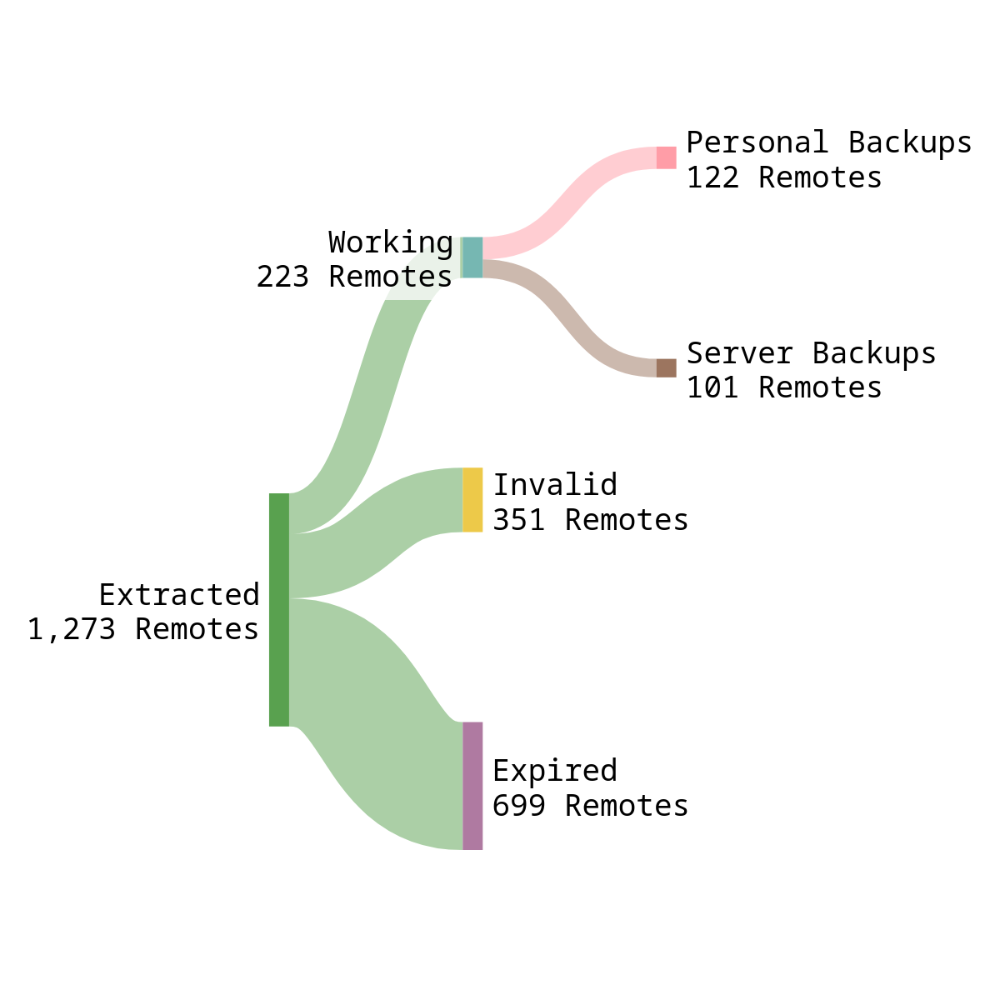

# Inception

As usual I was up at 3am last week fixing my Rclone config that i had forget the password to. Rebuilding all remotes from scratch was a boring task all about copy pasting usernames and passwords from my password manager. The process was so boring that I started to wonder if anyone has uploaded their unsecured Rclone config onto GitHub accidentally together with their other config files. A quick search on GitHub let me uncover 100+ Terabytes of files across many unsecured rclone configs. In this blog we are gonna see what i uncovered, how I did it and why this happens more often than we think.

# Rclone?

The open source community have built may amazing tools but there are few I would place in a time capsule so generations to come can experience. One of these after vim is Rclone.

Rclone in their own words is "rsync for cloud storage", rsync is another great tool for another day but this statement doesn't do justice to the amount of features Rclone enables its users to harness.

Rclone allows users to define a collection of "remote". Each remote is basically a connection to a cloud storage. Rclone supports over 50+ cloud providers including protocols like SFTP and WEBDAV. Below is the most important part of rclone, the `.conf` file.

```toml
[trusty-backup]
type = s3
provider = AWS
env_auth = false
secret_access_key = ADFBQREQ,ERNBQ,ENRBQ,NBRQ
region = eu-west-1
location_constraint = eu-west-1
acl = public-read
storage_class = STANDARD
chunk_size = 8M
upload_concurrency = 2
server_side_encryption = AES256
bucket_acl = public-read
```

Each remote has everything it needs to connect and transfer files from or to the supported cloud providers.

Rclone also has a very well documented, feature-rich CLI that allows creation and management of remotes, file transfers and everything in between. For people with multiple cloud drives across multiple providers Rclone saves valuable time.

# Unsecured Configs

As the `rclone.conf` has everything including passwords and access tokens for remotes its a bad idea to upload it to public servers like GitHub. To tackle this rclone has encryption for the config file built in. But most users accidentally upload their config file without encrypting them.

We are going to hunt for these files.

## Why do it?

My poor laptop ran for 3 whole nights to complete this little experiment but why?. I am doing this for the following goals.

1. Find how many people have unsecured configs on GitHub.
    
2. See if it is feasible for a bad actor to efficiently find these files like finding leaked API tokens.
    
3. Warn the owners of these unsecured files.
    

# How I did it?

The basic ideas is to scan for code files on GitHub for unsecured config files. So the flow is as follows

1. Search GitHub for `rclone.conf` files.
    
2. Extract remotes from each file.
    
3. Validate if the remote works.
    

## Search

To perform the search I opted to use [GitHub's REST API](https://docs.github.com/en/rest) through the awesome [PyGithub](https://pypi.org/project/PyGithub/) library. One caveat was that we can only fetch 1000 results form the API which in our case was more than enough. Following is the snippet of code that did the search.

```python
links = []
github = Github(auth=token, per_page=100)
search = github.search_code("filename:rclone.conf in:path")
for i in search:
    links.append(i.html_url)
```

This searches and retrieves the URL for each file. These URLs are then saved to a file for downloading in the next step.

## Extraction

Now we have a list of URLs for the files, these are in the normal [`github.com`](http://github.com) format, trying to download these will download the actual HTML content of the web page + file that the GitHub UI serves. To get just the file we have to convert these URLs to their raw format. Below is an example.

```plaintext
https://github.com/rclone/rclone/blob/359433017774a6d4647d50bf95e3adcbb373c9b4/bin/ci.rclone.conf
https://raw.githubusercontent.com/rclone/rclone/359433017774a6d4647d50bf95e3adcbb373c9b4/bin/ci.rclone.conf
```

To convert we have to replace [`github.com`](http://github.com) with [`raw.githubusercontent.com`](http://raw.githubusercontent.com) and remove `/blob` from the URL path. The conversion was done for all URLs from the previous step and were subsequently downloaded in async using `aiohttp` to make things a bit faster.

In total **937** files were downloaded.

## Processing

Each of the 937 files were processed and split into remotes. From 937 files we got **1263** remotes. After a lot of manual cleanup that number dropped to **922** remotes. Remotes that wont work for sure even without testing like `alias` and `union` remotes and remotes with broken properties were removed during the cleanup.

## Validation

This is the step that took the most time and a lot of tweaking for the script to complete. To validate each remote we use another great python library [`rclone_python`](https://pypi.org/project/rclone-python/) which is a wrapper to the underlying `rclone` binary.

To see if a remote is valid which is we are able to connect to it we can run the `rclone ls` command which will try to read the files in the home directory of a remote. To speed up our validation efforts we set the `max_depth` to **1** from the default **\-1** which will recursively list all files in the remote. The rclone command can be ran from python using the [`rclone.ls`](http://rclone.ls)`()` function provided by `rclone_python`.

```python
def worker(remote):
    try:
        rclone.ls(remote, max_depth=0)
        return True, remote
    except Exception as _:
        return False, remote
```

As apparent by the name of the function we multi threaded the validation to speed it up even more using a `ThreadPool`.

# Findings

After almost 3 days of processing here are my findings.



These findings shocked me, so many people have their personal backups exposed on the internet. I tried to find the total size of remotes but the process was too time consuming that I stopped after seeing 100+ Terabytes total in the console.

# Why this Happens

In my opinion there is 3 reasons for this lapse in operational security. Lets look at these in brief.

## Misplaced Trust

Most of these rclone configurations found were in the dotfiles repository of the users. If these people know that they are pushing this rclone config what allows them to not know that its not safe?

Pondering on this question i came across the fact that passwords for remotes are not stored in plaintext in the rclone config. So users assume that its safe to push the file **not aware** that any other rclone client can read the config file fine. This false trust I think is one of the major contributing factor for this scenario especially for beginners who assume that any base64 encoded text is encrypted.

## Active Protection

When the canon event of pushing a `.env` file to a GitHub repository happens you immediately get notified of the embarrassing event by GitHub's [Secret Scanning](https://docs.github.com/en/code-security/secret-scanning/introduction/about-secret-scanning) Feature but this active protection doesn't exists for rclone configurations.

## Awareness

Rclone has a built in feature for encrypting the configuration file. Most if not all people who use rclone on a daily basis have no reason to put it on a public rclone repository as usually these are pro or enterprise users who know what they are doing. Thus this feature is not mentioned in most tutorials.

Users who are both unaware of this feature and the fact that passwords are not encrypted in rest on the configuration file becomes the victim.

# Final Thoughts

Secure your rclone configurations and spread awareness about this. All things considered this was a fun little experiment for me. Reminding me once again that no matter how secure your code is, its only as secure as your user's security practices just as a chain is only strong as its weakest link.

